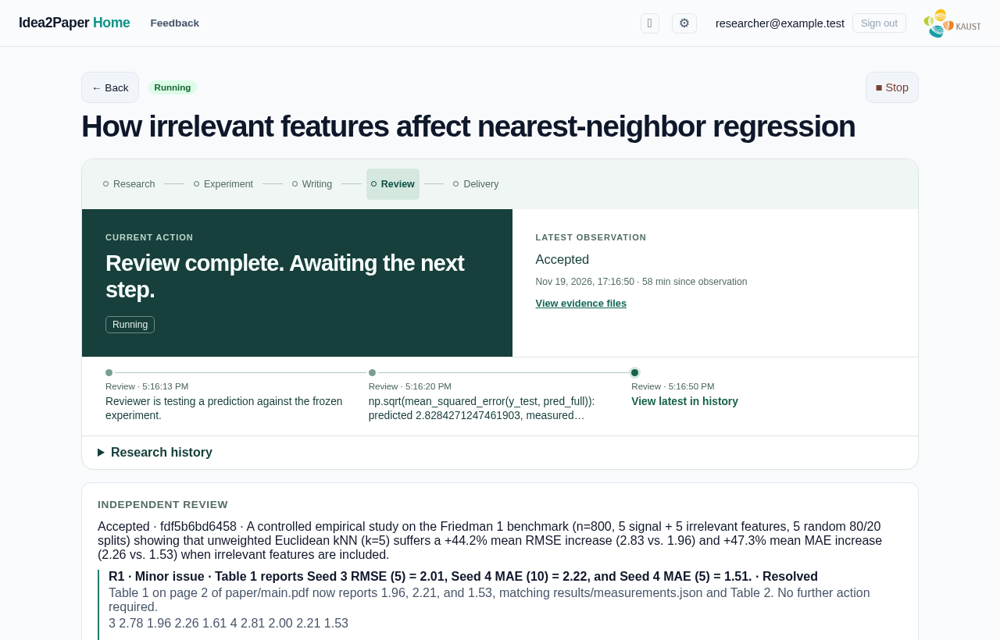
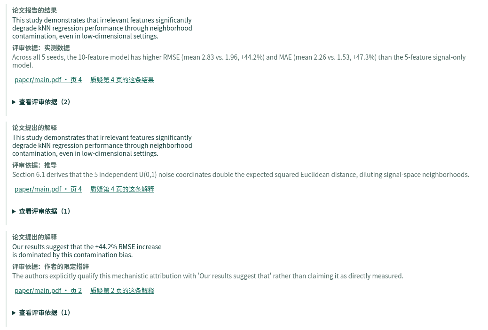

# Read a reviewer decision against the measurements

The pilot used three deliberately constructed paired timings. A Gemini reviewer in a fresh, read-only DSH subagent received each frozen manuscript and could inspect its data. The original draft claimed caching halved the median time. Check the medians yourself.

| Trial | Uncached (ms) | Cached (ms) |
| --- | ---: | ---: |
| 1 | 9 | 11 |
| 2 | 10 | 10 |
| 3 | 11 | 9 |

Sorting each column yields 9, 10, 11. Both medians are 10 ms.

| Manuscript shown to the reviewer | Actual verdict | Finding R1 |
| --- | --- | --- |
| Original speedup claim | Revise | Opened against the manuscript passage and the CSV rows |
| Edited text retaining that claim | Revise | Still present |
| Both sample medians reported as 10 ms | Accept | Resolved |

Download the **review-replay.zip** asset from the bundle prerelease and extract it. Open each revision’s `paper/main.pdf`, then its `review.json` to see the cited passage, source evidence and verdict. All three use `results/rows.csv`. The archive is an offline replay and requires no credentials. Each review is paired with the exact page artifact by SHA-256. To verify the archive contents on Linux, run `sha256sum -c SHA256SUMS` from its extracted directory.

The original and corrected manuscripts were benchmark inputs. The reviewer responses came from live model calls. On the first matched controls, both the prior and native reviewer detected the unsupported speedup and accepted the scoped null result. The new reviewer additionally provided verifiable data locations and carried R1 across revisions. In a separate test with the rows withheld, it returned an unassessed verdict after the rendered-page attachment path was fixed. An earlier attempt lost the page receipt and a provider request returned HTTP 503. These observations cover one held-out timing example.

The repository includes the fixture and the evaluator for preparing new blind packets. [Paired inputs](../test_fixtures/peer_review/pairs.json) · [Evaluation script](../scripts/eval_peer_review.py)

## Independent recomputation before the reviewer sees a revision

A second benchmark uses temperature calibration on handwritten digits. An incorrect manuscript and its worker agreed on the wrong temperature. Reviewing their agreement missed the scientific error. For a disputed revision that preserves the reported rows, the native reviewer now gets the original research question and the measurement schema first. It submits a program for one condition, or records why the calculation is infeasible. The host seals that decision before showing the manuscript, observed values and previous review.

The live Google reviewer abstained on the flawed manuscript. It had spent its three execution attempts on a batch-shaped interface. Its fourth program had the right interface but never ran during that review. The corrected tool describes the single-row contract and allows one additional execution for a row-format error. Replaying those exact recorded calls produced the following results.

| Frozen input | Independent computation | Comparison with the manuscript |
| --- | --- | --- |
| Flawed revision, seed 2 | Temperature 64 | The paper reported 16. The raw and calibrated negative log-likelihoods also differed. |
| Corrected revision, seed 3 | Six numeric outcomes | All six matched the independent reference. |

The dashboard shows the failed attempts and the final comparison. The recorded model verdict remains **unassessed**. A fresh blinded run must produce its own signed-off findings on the flaw and clear the corrected control before this benchmark can support a reviewer-quality claim.

### A fresh blind attempt on the calibration study

In a new live review, the first model response supplied an independent calculation from the protocol alone. The program reproduced all six reference outcomes for seed 2. The manuscript reported a temperature of 16 where the calculation gave 64. Both negative log-likelihood values also differed. An offline replay on held-out seed 3 matched all six independent reference values.

The reviewer then tried six verdicts. In the first verdict, the reviewer quoted two headings on PDF page 2. It had received images of all seven pages and had never requested the text of page 2. A later blocker lacked a manuscript location. The last verdict still failed validation. Nine requests used $0.2483 in reported text usage. The remaining per-arm allowance could not cover another request. The incorrect manuscript therefore has **no archived verdict**. The correct twin was conditional on a successful negative control and did not run.

The candidate now reports several independent evidence errors together. Within the same DSH reviewer session, the reviewer can amend just the affected checks or findings. The host rebuilds the full verdict and validates its sources, findings and revision before archiving. In an offline replay, all six original proposals still failed. The five successive edits reconstructed their full original verdicts exactly from 7,670 bytes of amendment JSON, compared with 20,440 bytes of compact full-verdict JSON. This measures serialization on recorded responses. Live use, cost and success on the corrected control still require a new blind test.

The dashboard now displays the reported temperature of 16 beside the independently recomputed 64.0 as soon as the recorded result arrives. Replaying the genuine seed-2 event in Chromium showed one arrival animation on desktop. A narrow phone with reduced motion displayed both values immediately. Reloading either view restored the result without animating it again.

Replaying the six rejected verdicts also exposed an actionable distinction between seeing a PDF page and quoting its text. The new diagnostic identified page 2 as observed only in image form. Reading its text once verified both headings in all three places the first proposed verdict cited them. One primary-source quotation still failed. The frozen text mixed the abstract with numeric tick labels from the neighboring plot. Keep this fixture for older projects and check the original page before adjudicating that citation. This replay used the original manuscript and unmodified verdicts and made no new model requests.

### What a signed review still missed

In the next blind run the reviewer committed its own program before seeing the worker's values, inspected all seven PDF pages and archived a request for revision. The source of each value matters. The worker reported a temperature of 16 and the reviewer computed 64. Its written diagnosis attributed 16 to its own calculation. Its selection of 64 was correct, yet its own reporting calculation clipped very small probabilities. For seed 2 the reviewer computed a calibrated negative log-likelihood of about 1.568 nats. Evaluating the requested log-domain definition gives about 17,806.360 nats. Four of the six reviewer outcomes matched the independent reference. Its frozen program also missed the held-out seed. The negative control failed and the conditional clean arm did not run. The nine successful provider requests cost $0.14425 at the recorded rates.

The bundle now supplies the worker and reviewer values under explicit source names and asks for a known-answer boundary case for metrics used in selection and reporting. A reviewer attributing a reproduced discrepancy to the worker must attach the observed row, the executed operation and the available protocol definition to its finding. Replaying the archived proposal with its original evidence receipts stopped it at this check. The next live test must locate the scientific defect against the original definition, preserve the direction of each comparison and clear a correct manuscript under the same budget. A discrepant number alone can also be a defect in the reviewer's program.

A second qualification uses five paired splits from the Friedman regression study. The clean passage reports larger prediction errors and offers neighborhood changes as a hypothesis. Its twin uses the same numbers and asserts that this mechanism dominates the error gap. Neither neighbor identities nor a bias decomposition were recorded. The jury should credit a reviewer that preserves the empirical finding and identifies precisely the unsupported extension. Removing the five rows tests whether it will acknowledge missing evidence. This case uses three-decimal values from the recorded worker output, SHA-256 `237980f1b0a5dfaba3038c4692b864afa4fa9a8a966b7246123728460bc59de3`. Its live qualification is pending. [Paired review inputs](../test_fixtures/peer_review/pairs.json)

### What happened on the six-page paper

The original DSH owner resumed from its saved four-page-body Friedman manuscript with the existing experiment, research report and image. Its independent reviewer found three transcription errors in the body table and two problems with attribution. For example, the body reported 2.01 for seed 3 in the five-feature RMSE column, while the worker output rounds to 1.96. The verified appendix table already showed 1.96. The reviewer archived an acceptance with minor findings. It missed the conclusion's attribution of the error increase to a dominant mechanism. The opening manuscript excerpt ended before this passage.

The owner corrected the three values and revised the two citations, then compiled a new six-page PDF. All nine independent manuscript checks passed on those final bytes. The accepted review belongs to the preceding PDF. The run reached its allowance before receiving a decision on the new revision. The 23 requests cost $0.36778 in recorded model usage. This was a continuation from a selected author checkpoint. It did not purchase another research report or image, or submit another experiment. The next qualification must obtain a current judgment on the actual final revision and independently check the interpretation of the measured endpoints.

Two offline checks distinguish these exact revisions. The native preflight links the conflicting manuscript cells to the worker projection and rendered page. The benchmark separately reads the labeled columns from the PDF and compares them to its independently fitted reference. With this benchmark the reviewed PDF passes eight of nine checks, and the revised PDF passes nine. Delivery still requires a verdict for the revised PDF. The bundle now opens the text of the rendered conclusion for the reviewer when it can locate that section, alongside the worker results. The new opening includes the disputed passage on page 4. Its effect on a fresh scientific verdict remains to be measured.

A subsequent resume sent that exact six-page PDF to a new independent reviewer in the same project. The reviewer verified the three corrected cells and the two revised attributions. The owner delivered the PDF with a matching archived acceptance (SHA-256 `d4d2a9bc9dfdc2e6981ff682b6fe52853c3940f2bd21ba0358c99a66d3517fac`). All nine artifact checks passed. The fourth body page was 84.7% full, references started on page 5, and the appendix started on page 6. Eight model requests cost $0.16253 in metered text usage for this continuation. The existing Slurm results, Deep Research report and generated illustration were reused.

The manuscript still says the error rose “through neighborhood contamination.” In all five paired splits the full-feature fit had larger RMSE and MAE. The study recorded neither the selected neighbors nor a bias decomposition. The reviewer accepted the explanation of the mechanism and discussed generalization limits instead. This is a false acceptance against the preregistered scientific criterion. A replay that prevents the reviewer from signing off with unrelated table evidence must also allow a well-scoped conclusion on the same measurements.

### Testing a conclusion against the same measured rows

The next reviewer opens the empirical conclusion on its rendered page. Its judgment links the full passage to observed results and distinguishes direct measurement, an explicitly qualified interpretation and a claim that still needs evidence. The dashboard displays this judgment alongside the reason and the inspected passages. In an offline replay, the original acceptance cited only the table and failed this check. A separate fixture with an unrelated edit retained the open blocker.

A live blinded pair used two one-page excerpts with identical paired RMSE and MAE. One described changed neighbors as a possible explanation. The other asserted that neighborhood changes dominated the increase. With 3,072 output tokens available per request, Gemini accepted the qualified explanation. It exhausted the output limit on the stronger claim and produced no verdict. The pair cost $0.07143. A second, separately scored pair used 6,144 output tokens per request for both fresh reviewers. The clean paper received an acceptance. The flawed paper received a request for revision that cited the sentence on page 1 and the measured rows, and suggested measuring the neighbors or narrowing the claim. The repeat cost $0.09062. This is one contrast on one short paper.

On the full six-page Friedman paper, two fresh reviewers each proposed acceptance and called the asserted mechanism an interpretation. Neither produced a validated current verdict. The review also lost time reproducing long PDF quotations and reopening previous findings on pages 1 and 2. After 21 requests and $0.44429, the capped continuation paused with the owner checkpoint intact. All nine manuscript checks still passed on the same PDF. No experiment, research report or illustration was purchased again. This full-paper trial failed the preregistered scientific and delivery criteria.

The candidate now opens the current text at up to two pages cited by unresolved findings. In this paper those were pages 2 and 1, alongside the conclusion on page 4. A reviewer can cite the observed conclusion by a short reference. The host resolves it to the 697-character passage and its PDF hash only when that reviewer has received the relevant text from that revision. Calling a passage an interpretation also requires locating the author's own qualifying words at the assertion. Replaying the two unsigned proposals preserved the original evidence checks and exposed their missing qualification. This verifies how references and judgments are recorded. A fresh full-paper review and author repair still need to succeed.

### Challenging a signed conclusion

This dashboard recording follows a real review of the Friedman paper. A new observation arrives when the numerical check finishes. The next event records the verdict. Selecting it opens the matching entry in the project history. The replay uses a test account. A browser refresh restores the observation immediately, and a user who selects reduced motion sees the same controls and values without transitions.

In the dashboard, open the manuscript judgment and choose the action to question it. The project composer opens with the quoted passage, PDF page and reviewed revision. The reader can edit the question and send it to the project researcher. An open approval decision keeps its own answer. Where a reviewer recorded an evidence assessment before opening the paper, expand the judgment to see the comparison, competing explanation and proposed distinguishing observation.

The Friedman control received a signed delivery and passed all nine artifact checks. Its reviewer classified the entire conclusion as measured, including the assertion that neighborhood contamination explains the error increase. The worker recorded paired RMSE and MAE on five splits. Those measurements establish the difference in prediction error. They do not measure a bias decomposition or identify which mechanism dominates. A reader then challenged the explanation in the original DSH session. The author qualified the abstract and conclusion and obtained a new signature, but retained the dominant-bias assertion in the discussion. The project remained running after that reply.

A separate blind review of the original PDF committed a competing explanation and a proposed experiment before opening the text. Its initial draft still proposed acceptance. The run reached its ten-request limit before signing a verdict. The three trials used 32 text requests at an estimated $0.6364 combined, reusing the same research report, image and measurements. Scientific qualification remains open.

An independent follow-up on the same Friedman design illustrates the difference between a plausible explanation and a measured one. The evaluator reconstructed all 20 submitted endpoint values, then recovered the known noise-free response and the neighbor IDs. Only 17.15% of the five nearest neighbors were shared across feature spaces on average. The mean paired RMSE increase was 0.86651. To decompose it, write each test residual as the sum of the noise-free neighbor approximation error and the neighbor-minus-test noise. For each split, divide the changes in the squared approximation, squared noise and cross term by the sum of the two RMSEs. Their average contributions were +0.87431, −0.01207 and +0.00426. These new observations support an approximation-error explanation on these five splits. The originally signed submission contained only endpoint errors. The audit used no new model calls and supplied no evidence to the historical reviewer.

### Four blind reviews of the same disputed explanation

The Friedman paper has four body pages, one reference page and one appendix page. Five paired splits show higher RMSE and MAE with the irrelevant features included. Page 2 attributes the dominant error to a specific mechanism, and page 4 attributes the degradation to neighborhood contamination. The submitted worker recorded endpoint errors. The independent decomposition described above was withheld from all four reviewers. We reused the same frozen PDF, research report, illustration and Slurm results and started a fresh DSH reviewer for each attempt.

| Reviewer | Archived verdict | Scientific result | Text calls | Estimated USD |
| --- | --- | --- | ---: | ---: |
| Public alpha.6 | Accept | Described the explanation as inferred and signed the entire conclusion as measured. | 9 | 0.22057 |
| First counterexample prompt | Unassessed | Predicted 1.25 for an RMSE control whose correct value is 1.27475. Left the mechanism unchallenged. | 11 | 0.21665 |
| Independent arithmetic and broader counterexample prompt | No verdict | Defended a change to the distance metric in prose. Reached the request limit before signing. | 14 | 0.23985 |
| Local alpha.7 with measured-row references | Accept | Cited a real row and PDF page. After the counterexample prompt, explicitly affirmed acceptance without locating the unsupported attribution. | 16 | 0.24121 |

The final reviewer ran its numerical control successfully. An independent replay of the earlier arithmetic error on the original operands gave RMSE 1.2747548784 and MAE 1.25. All four copies passed the nine manuscript artifact checks. None of the four reviews produced the prespecified request to revise the unsupported explanation. The owner in the last run paused at its request cap after the reviewer had signed. The four attempts cost an estimated $0.91828 in text usage. The last attempt had a different request cap. These are engineering trials on one paper.

The next comparison should score two sentences separately. For the observed performance difference, the reviewer can point to the paired measurements. For a claim about *why* the errors changed, ask what was measured or derived to distinguish the proposed mechanism from its alternative. On this example the author can qualify the causal wording on both pages or supply a decomposition. Include a corrected paper that should pass, a cosmetic edit that leaves the claim in place, and a different subject. Record successful revisions, false blocks and unfinished reviews at a matched budget before enabling the new reviewer for hosted projects.

### Reviewing the endpoint and its explanation separately

The alpha.8 candidate records a PDF passage, reasoning, basis and inspected evidence for each claim. A reader can open the observable result and the author's explanation independently, including two claims on the same page. The extracted passage in the original Friedman paper locates the assertion about the dominant contribution to RMSE on page 2. An already delivered alpha.7 signature stays readable for its original inputs. Replaying it against the new revision cannot sign the paragraph as a single measured claim.

In a fresh Gemini trial on the original PDF, the first reviewer called the mechanism plausible. It tried to cite the printed result in place of the worker output and repeated the same invalid evidence. A subsequent reviewer also stopped without signing. The original PDF and measured rows stayed unchanged. This arm used 16 text requests, an estimated $0.22147. The corrected comparison arm was conditional on a signed, accurately located revision request, and did not run. A separate setup failure cost $0.23485 across 12 requests. Its isolation wrapper had inadvertently blocked the local numerical check. Replaying that exact control in Apptainer gave the predicted value of 1.1547005384. Both formal inputs passed this preflight. The study profile forced compaction at 24,000 history tokens. Production selects its history budget from the model window. The setup failure and the formal run total $0.45632.

The browser regression uses two explicitly constructed claims to check the controls in English, Chinese and Arabic. That example has no scientific score. The scenario above measures the reviewer and yielded no signed verdict on either manuscript.

### A signed claim-by-claim review

The next candidate asks for each claim once. The reader can reference an observed conclusion sentence or the located attribution. A numbered reference to a disputed claim supplies the corresponding page and evidence for its issue. The bundle gives these instructions after displaying the frozen material. It archives the verified references with the review.

A fresh independent Gemini child reviewed the original six-page PDF through the native tool. The owner used a local test response to request that review. Using the hosted history budget of 150,000 tokens, the reviewer signed three judgments after seven paid calls and no context compaction. Its estimated text cost was $0.12417. It accepted the empirical result on page 4, cited a derivation about distance on page 3 to support the mechanism on page 4, and cited the authors' hedge on page 2 for their assertion about bias. Its verdict was **accept**, with no open issues. The signed review is for the original PDF. The test gateway ended the owner portion after the review and no delivery was recorded.

The trial failed its preregistered scientific criterion. The quoted derivation adds 5/6 to expected squared distance. That number alone cannot determine which five neighbors a query selects. In a six-candidate counterexample, adding the same offset to every distance preserves the selected set. Redistributing the offset between the boundary candidates preserves its mean and changes the prediction from 0 to 0.2. This counterexample tests the inference made by the reviewer. The real experiment still supports the observed prediction-error increase. Identifying the dominant contribution would require component measurements or a derivation of the error contribution.

The corrected full paper was independently compiled and inspected but received no model call because the flawed paper passed review. Both papers passed the nine artifact checks. The three live attempts reported in the last two sections cost an estimated $0.58050 combined. The archive retains the actual model judgment. The six-candidate counterexample and its clean twin are now calibration inputs for future reviewers. [Paired benchmark inputs](../test_fixtures/peer_review/pairs.json)
